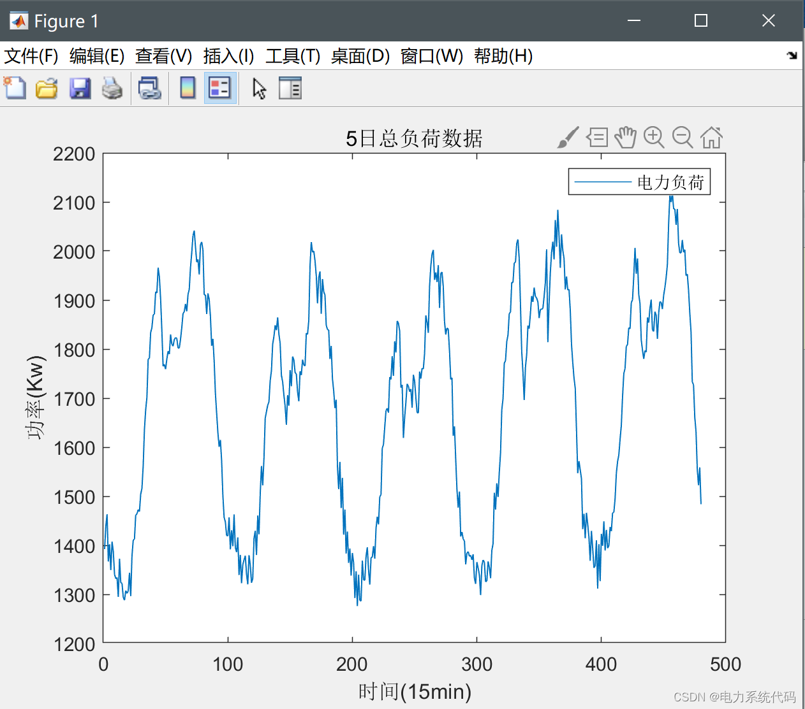
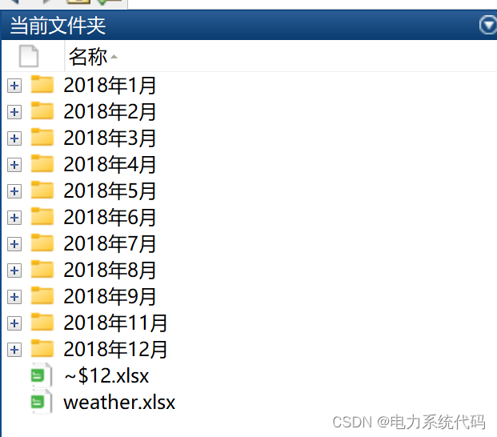
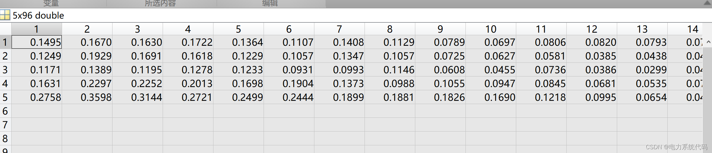
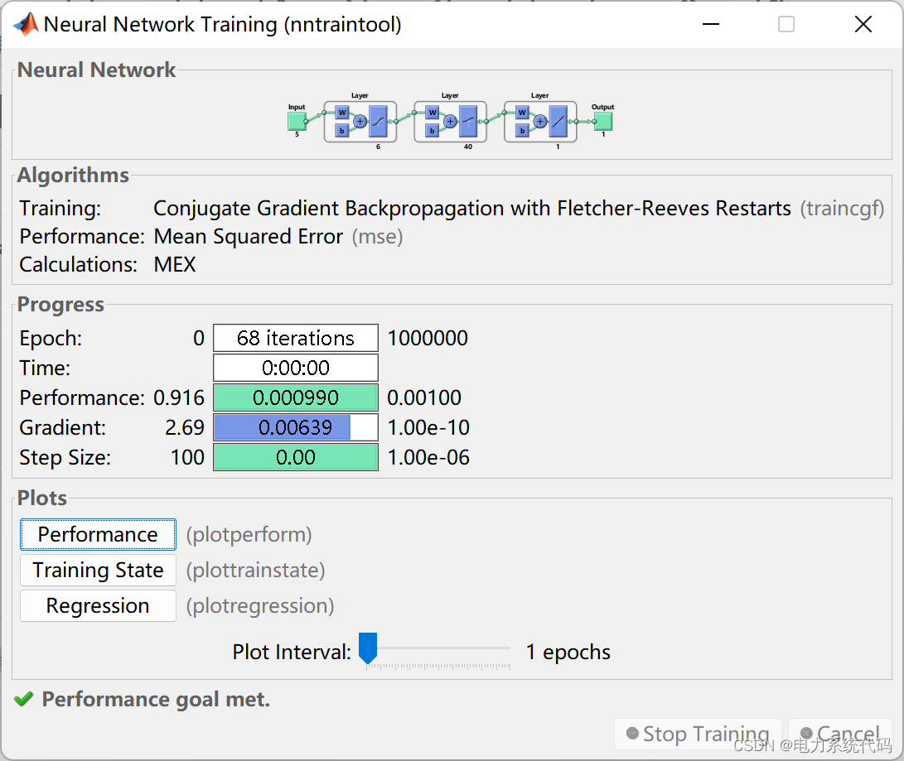
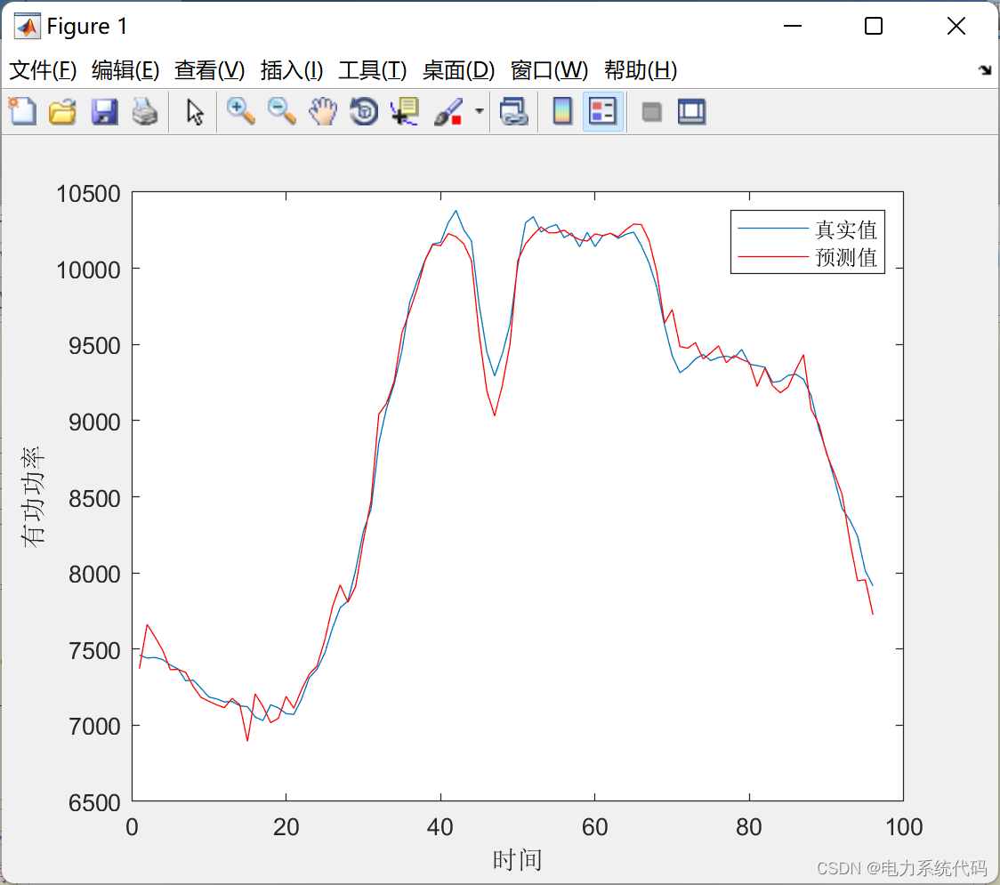

# Short-term Load Forecasting Based on BP Neural Network in Power System

​  
Contents
Abstract
1. Import of Electricity Load Data
II. Normalization of input and output data
III. Establishment and Training of BP Neural Networks
IV. Load Forecasting with Test Data
5. Matlab Code Display
Editor
The paper implements a simple power load regression prediction task using BP neural network. The main steps include: data importation, data normalization, the establishment of BP neural network, training of BP neural network, use of test data to predict load situation, error analysis and plotting.
1. Power load data importing uses the xlread function in Matlab to extract power load data from a specified excel file. You can set the number of days you need to import yourself. Here set the import of 5 days data. As shown in the figure below:
Editor
Other all data:
Editor
II. Although the input and output data are normalized, the distribution of inputs in different layers of neural networks is different. However, the sample markers that "point to" are ultimately constant. The probability of the edge differs, but the conditional probability remains the same. To reduce the impact of distribution changes, Normalization can be used. Map the data distribution to a definite interval. In neural networks, Common normalization strategies include BN (Batch Normalization). WN(Weight Normalization),  LN(Layer Normalization),  IN(Instance Normalization).
Here, the max-min normalization method is used to normalize all data to the range of 0-1. The normalized data is as follows:
Editor
3. Establish and train BP neural network with specified input feature count as 1. Output the number of features is 1. Set the number of neurons to 100. Set the learning rate to 0.001. Construct a BP neural network using the newff function in Matlab. Train the BP neural network using the train function:
Editor
IV. Load Forecasting with Test Data
Test Results:
Editor
V. Matlab Code Exhibition
This article only displays a part of the code, the complete code can be found here:
clc;\nclear;\nclose all;\n%% Import data\nmonth = 12;  %Training month\nday_start = 5; % Start Date\nday_len = 5;  %Training days\n\nfile_path = '2018Load Forecast Data';\nmap_maxmin = [];\noutput = [];\n%% Data grouping and normalization\nfor day = day_start:1:(day_start + day_len - 1)\n    [raw_data, raw_max ,raw_min] = read_load_data_from_excel(file_path, month ,day); % Reading data from a folder\n    % Input and output normalization\n    data_temp =  my_map(1, raw_data, raw_max, raw_min, 1, 0); \n    map_maxmin = cat(1, map_maxmin, [0 1]);\n    output = cat(1, output, data_temp);\n    target_day = day + 1;\nend\n[target_data, target_max, target_min] = read_load_data_from_excel(file_path, month ,target_day);\nt_d =  my_map(1, target_data, target_max, target_min, 1, 0);\n%% Create network\n  
​  

## Images

<!-- PAYMENT_BLOCK -->

## Get this dataset

- Payment link (Stripe): [Buy now](https://buy.stripe.com/3cs8yP7sY87d0vu9AB)
- Payment QR code: 

<!-- /PAYMENT_BLOCK -->
